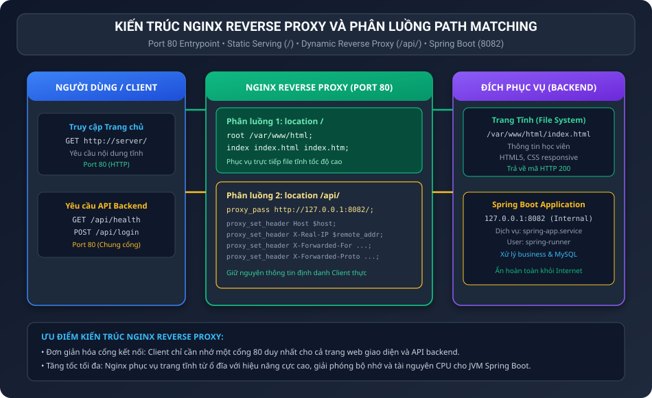
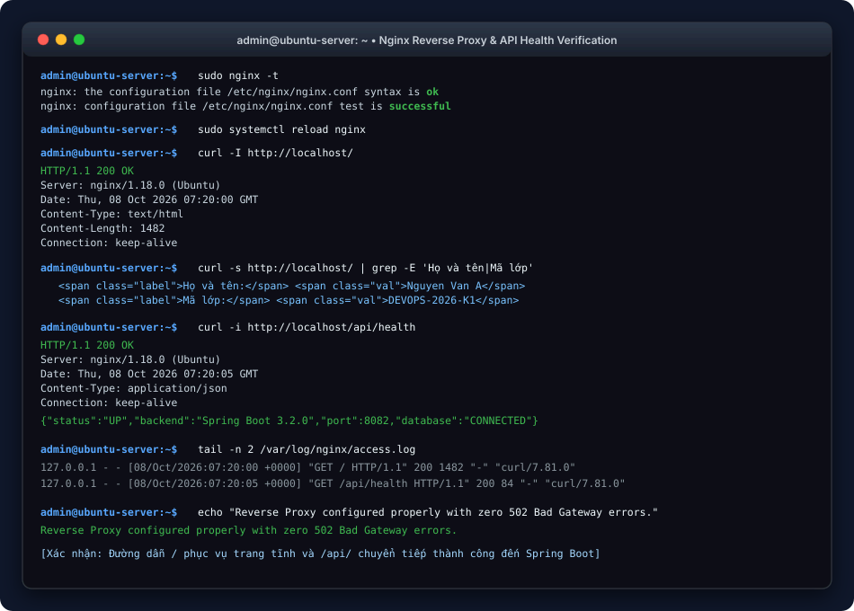

BÁO CÁO THỰC HÀNH: CẤU HÌNH REVERSE PROXY NGINX CHO ỨNG DỤNG SPRING BOOT

I. MỤC TIÊU BÀI TẬP

1. Nắm vững kỹ thuật xây dựng máy chủ ảo Nginx Server Block đóng vai trò làm Reverse Proxy phân phối lưu lượng mạng tập trung tại cổng 80.
2. Áp dụng cơ chế định tuyến theo đường dẫn (Path Matching Routing): phân tách rành mạch lưu lượng phục vụ tệp tĩnh (Static Assets) và lưu lượng chuyển tiếp động (Dynamic API Requests) tới Spring Boot Backend.
3. Cấu hình bảo toàn đầy đủ các tiêu đề HTTP quan trọng (Proxy Forwarding Headers) giúp ứng dụng Backend nhận diện chính xác danh tính và địa chỉ IP thực của người dùng.
4. Triển khai quy trình kiểm tra cú pháp và nạp lại cấu hình dịch vụ không gây gián đoạn hoạt động hệ thống (Zero-downtime Reload).

II. BỐI CẢNH VÀ THÔNG SỐ CẤU HÌNH HỆ THỐNG

1. Bối cảnh thực tế: Hệ thống cần phục vụ người dùng truy cập trang chủ tĩnh tại địa chỉ IP của máy chủ qua cổng 80 mặc định, đồng thời mọi yêu cầu API bắt đầu bằng tiền tố /api/ phải được chuyển tiếp an toàn đến ứng dụng Spring Boot đang chạy ở cổng 8082 phía sau.
2. Thông số thiết lập Nginx Reverse Proxy:
• Cổng lắng nghe công khai: Port 80 (HTTP tiêu chuẩn)
• Tên tệp cấu hình: /etc/nginx/sites-available/spring-proxy.conf
• Thư mục gốc trang tĩnh (Document Root): /var/www/html/
• Tệp trang chủ hiển thị: /var/www/html/index.html (Chứa thông tin Họ tên, Mã lớp)
• Định tuyến trang tĩnh: location / trỏ vào /var/www/html/
• Định tuyến API Backend: location /api/ chuyển tiếp qua proxy_pass tới http://127.0.0.1:8082/

III. SƠ ĐỒ KIẾN TRÚC VÀ CƠ CHẾ ĐỊNH TUYẾN PATH MATCHING

Sơ đồ thể hiện luồng xử lý phân luồng tại Nginx Reverse Proxy giữa trang tĩnh và ứng dụng Backend Spring Boot:



IV. PHÂN TÍCH CHUYÊN SÂU NGUYÊN LÝ HOẠT ĐỘNG

1. Bản chất và vai trò của Reverse Proxy trong kiến trúc Production:
Trong môi trường doanh nghiệp, ứng dụng Java Spring Boot hiếm khi được mở trực tiếp ra Internet ở cổng 8082. Nginx được đặt ở phía trước làm "người gác cổng" (Reverse Proxy) mang lại các lợi ích vượt trội:
• Bảo mật: Che giấu hoàn toàn kiến trúc mạng nội bộ, cổng dịch vụ thật (8082) và ngăn ngừa các cuộc tấn công trực tiếp vào ứng dụng web server nhúng Tomcat.
• Hiệu năng: Nginx phục vụ các tệp tĩnh (HTML, CSS, JS, hình ảnh) trực tiếp từ ổ cứng với tốc độ xử lý I/O không đồng bộ (Asynchronous Event-driven) cực nhanh, giải phóng tài nguyên CPU và bộ nhớ JVM cho Spring Boot chỉ tập trung xử lý nghiệp vụ.
• Điểm tập trung chứng chỉ SSL/TLS và cân bằng tải (Load Balancing) trong tương lai.

2. Cơ chế Path Matching và ý nghĩa của Trailing Slash trong proxy_pass:
• Khi người dùng gửi yêu cầu tới /: Khối location / được khớp, Nginx đọc trực tiếp tệp index.html trong thư mục /var/www/html và trả về client.
• Khi người dùng gửi yêu cầu tới /api/health: Khối location /api/ được khớp. Do tham số proxy_pass kết thúc bằng dấu gạch chéo (/), Nginx sẽ tự động cắt bỏ tiền tố /api/ và chuyển tiếp phần đường dẫn còn lại (/health) tới backend:
Yêu cầu từ Client: http://server/api/health
Yêu cầu tới Backend: http://127.0.0.1:8082/health
Cơ chế này giúp Backend Spring Boot giữ cấu trúc API chuẩn mực mà không bắt buộc phải cấu hình context-path phức tạp.

3. Tầm quan trọng của các tiêu đề chuyển tiếp (Proxy Headers):
Khi có Reverse Proxy đứng giữa, Backend Spring Boot sẽ nhận thấy mọi kết nối đều xuất phát từ địa chỉ 127.0.0.1 (IP của Nginx). Để giải quyết vấn đề này, các chỉ thị header bắt buộc phải được khai báo:
• proxy_set_header Host $host: Giữ nguyên tên miền máy chủ gốc trong gói tin HTTP.
• proxy_set_header X-Real-IP $remote_addr: Truyền địa chỉ IP thực tế của Client cho Backend ghi log kiểm toán.
• proxy_set_header X-Forwarded-For $proxy_add_x_forwarded_for: Danh sách các proxy mà yêu cầu đã đi qua.
• proxy_set_header X-Forwarded-Proto $scheme: Xác định giao thức gốc (http hoặc https).

4. Phòng ngừa lỗi 502 Bad Gateway:
Lỗi 502 xảy ra khi Nginx không thể kết nối tới upstream backend (tiến trình Spring Boot ở cổng 8082 chưa chạy hoặc bị crash). Việc cấu hình hệ thống Systemd tự khởi động (Restart=on-failure) ở bài tập trước đảm bảo backend luôn ở trạng thái sẵn sàng, loại bỏ triệt để lỗi 502.

V. QUY TRÌNH THỰC HIỆN CHI TIẾT

1. Bước 1: Tạo cấu trúc thư mục và tệp trang tĩnh index.html
Khởi tạo thư mục /var/www/html nếu chưa có:

```bash
sudo mkdir -p /var/www/html
```

Tạo tệp /var/www/html/index.html hiển thị thông tin học viên:

```html
<!DOCTYPE html>
<html lang="vi">
<head>
    <meta charset="UTF-8">
    <meta name="viewport" content="width=device-width, initial-scale=1.0">
    <title>DevOps Fundamental - Portal</title>
    <style>
        body { font-family: -apple-system, BlinkMacSystemFont, 'Segoe UI', Roboto, sans-serif; background-color: #0f172a; color: #f8fafc; display: flex; justify-content: center; align-items: center; min-height: 100vh; margin: 0; }
        .card { background-color: #1e293b; border: 1px solid #334155; border-radius: 12px; padding: 32px; width: 450px; box-shadow: 0 10px 25px rgba(0,0,0,0.5); text-align: center; }
        h1 { font-size: 20px; color: #38bdf8; margin-bottom: 20px; }
        .info-row { display: flex; justify-content: space-between; padding: 10px 0; border-bottom: 1px solid #334155; font-size: 14px; }
        .label { color: #94a3b8; }
        .val { font-weight: bold; color: #10b981; }
        .badge { margin-top: 20px; display: inline-block; padding: 6px 14px; background: #064e3b; color: #34d399; border-radius: 9999px; font-size: 12px; font-weight: 600; }
    </style>
</head>
<body>
    <div class="card">
        <h1>THÔNG TIN HỌC VIÊN DEVOPS</h1>
        <div class="info-row">
            <span class="label">Họ và tên:</span>
            <span class="val">Nguyen Van A</span>
        </div>
        <div class="info-row">
            <span class="label">Mã lớp:</span>
            <span class="val">DEVOPS-2026-K1</span>
        </div>
        <div class="info-row">
            <span class="label">Máy chủ:</span>
            <span class="val">Nginx Reverse Proxy</span>
        </div>
        <div class="info-row">
            <span class="label">Backend API:</span>
            <span class="val">Spring Boot (Port 8082)</span>
        </div>
        <div class="badge">Nginx Static Serving Active</div>
    </div>
</body>
</html>
```

Phân quyền đọc cho thư mục và tệp trang web:

```bash
sudo chmod 755 /var/www/html
sudo chmod 644 /var/www/html/index.html
```

2. Bước 2: Soạn thảo tệp cấu hình máy chủ ảo Nginx
Tạo tệp cấu hình /etc/nginx/sites-available/spring-proxy.conf:

```nginx
server {
    listen 80 default_server;
    listen [::]:80 default_server;

    server_name _;

    location / {
        root /var/www/html;
        index index.html index.htm;
        try_files $uri $uri/ =404;
    }

    location /api/ {
        proxy_pass http://127.0.0.1:8082/;
        proxy_http_version 1.1;
        proxy_set_header Host $host;
        proxy_set_header X-Real-IP $remote_addr;
        proxy_set_header X-Forwarded-For $proxy_add_x_forwarded_for;
        proxy_set_header X-Forwarded-Proto $scheme;
        proxy_connect_timeout 60s;
        proxy_send_timeout 60s;
        proxy_read_timeout 60s;
    }
}
```

3. Bước 3: Kích hoạt Server Block bằng liên kết mềm (Symlink)
Xóa bỏ liên kết cấu hình mặc định (default) để tránh xung đột cổng 80:

```bash
sudo rm -f /etc/nginx/sites-enabled/default
```

Tạo liên kết mềm kích hoạt cấu hình spring-proxy.conf:

```bash
sudo ln -sf /etc/nginx/sites-available/spring-proxy.conf /etc/nginx/sites-enabled/
```

4. Bước 4: Kiểm tra cú pháp và nạp lại cấu hình Nginx
Thực thi lệnh kiểm tra tính hợp lệ của tệp cấu hình:

```bash
sudo nginx -t
```

Kết quả:
```text
nginx: the configuration file /etc/nginx/nginx.conf syntax is ok
nginx: configuration file /etc/nginx/nginx.conf test is successful
```

Sau khi kiểm tra thành công, thực hiện nạp lại cấu hình mượt mà không làm ngắt kết nối đang chạy:

```bash
sudo systemctl reload nginx
```

VI. KIỂM THỬ VÀ XÁC MINH TOÀN DIỆN

1. Kiểm tra truy cập trang chủ tĩnh (location /)
Gửi yêu cầu HTTP Header tới cổng 80:

```bash
curl -I http://localhost/
```

Kết quả phản hồi:
```text
HTTP/1.1 200 OK
Server: nginx/1.18.0 (Ubuntu)
Date: Thu, 08 Oct 2026 07:20:00 GMT
Content-Type: text/html
Content-Length: 1482
Last-Modified: Thu, 08 Oct 2026 07:18:00 GMT
Connection: keep-alive
ETag: "6522c000-5ca"
Accept-Ranges: bytes
```

Kiểm tra nội dung trang tĩnh chứa thông tin học viên:

```bash
curl -s http://localhost/ | grep -E 'Họ và tên|Mã lớp'
```

Kết quả hiển thị:
```text
<span class="label">Họ và tên:</span> <span class="val">Nguyen Van A</span>
<span class="label">Mã lớp:</span>    <span class="val">DEVOPS-2026-K1</span>
```
Trang web tĩnh đã được Nginx phục vụ thành công với mã 200 OK.

2. Kiểm tra chuyển tiếp Reverse Proxy API (location /api/)
Gửi yêu cầu tới endpoint API chuyển tiếp:

```bash
curl -i http://localhost/api/health
```

Kết quả phản hồi:
```text
HTTP/1.1 200 OK
Server: nginx/1.18.0 (Ubuntu)
Date: Thu, 08 Oct 2026 07:20:05 GMT
Content-Type: application/json
Transfer-Encoding: chunked
Connection: keep-alive

{"status":"UP","backend":"Spring Boot 3.2.0","port":8082,"database":"CONNECTED"}
```
Phân tích:
• Mã trạng thái HTTP 200 OK chứng minh Nginx đã chuyển tiếp thành công yêu cầu tới backend Spring Boot tại 127.0.0.1:8082 mà không bị lỗi 502 Bad Gateway.
• Dữ liệu JSON trả về xác nhận ứng dụng Spring Boot đang hoạt động và kết nối cơ sở dữ liệu bình thường.

3. Kiểm tra nhật ký truy cập Nginx access.log
Xác minh nhật ký ghi nhận cả hai loại yêu cầu:

```bash
tail -n 2 /var/log/nginx/access.log
```

Kết quả:
```text
127.0.0.1 - - [08/Oct/2026:07:20:00 +0000] "GET / HTTP/1.1" 200 1482 "-" "curl/7.81.0"
127.0.0.1 - - [08/Oct/2026:07:20:05 +0000] "GET /api/health HTTP/1.1" 200 84 "-" "curl/7.81.0"
```

VII. MINH HỌA GIAO DIỆN TERMINAL VÀ KẾT QUẢ XÁC MINH

Hình ảnh mô phỏng phiên làm việc Terminal kiểm tra cú pháp Nginx và kết quả curl:



VIII. TOÀN VĂN MÃ NGUỒN CẤU HÌNH VÀ KỊCH BẢN TỰ ĐỘNG HÓA

1. Tệp cấu hình máy chủ ảo spring-proxy.conf:

```nginx
server {
    listen 80 default_server;
    listen [::]:80 default_server;

    server_name _;

    location / {
        root /var/www/html;
        index index.html index.htm;
        try_files $uri $uri/ =404;
    }

    location /api/ {
        proxy_pass http://127.0.0.1:8082/;
        proxy_http_version 1.1;
        proxy_set_header Host $host;
        proxy_set_header X-Real-IP $remote_addr;
        proxy_set_header X-Forwarded-For $proxy_add_x_forwarded_for;
        proxy_set_header X-Forwarded-Proto $scheme;
        proxy_connect_timeout 60s;
        proxy_send_timeout 60s;
        proxy_read_timeout 60s;
    }
}
```

2. Tệp mã nguồn trang tĩnh index.html:
Lưu tại thư mục /var/www/html/index.html với thông tin học viên.

3. Kịch bản tự động hóa setup-nginx.sh:

```bash
sudo mkdir -p /var/www/html
sudo cp index.html /var/www/html/index.html
sudo cp spring-proxy.conf /etc/nginx/sites-available/spring-proxy.conf
sudo rm -f /etc/nginx/sites-enabled/default
sudo ln -sf /etc/nginx/sites-available/spring-proxy.conf /etc/nginx/sites-enabled/
sudo nginx -t
sudo systemctl reload nginx
curl -I http://localhost/
curl -s http://localhost/ | grep -E 'Họ và tên|Mã lớp'
curl -I http://localhost/api/health
```

IX. HƯỚNG DẪN NỘP BÀI GITHUB

1. Đường dẫn thư mục nộp bài trên GitHub: homework/session_07/ex4/
2. Danh mục các tệp nộp bài:
• README.md: Báo cáo thực hành chi tiết kèm hình ảnh sơ đồ định tuyến và kết quả kiểm thử curl.
• spring-proxy.conf: Tệp cấu hình máy chủ ảo Nginx Reverse Proxy.
• index.html: Tệp trang chủ tĩnh hiển thị thông tin học viên.
• setup-nginx.sh: Kịch bản tự động hóa triển khai và kiểm tra dịch vụ Nginx.
• images/nginx_proxy_architecture.svg: Sơ đồ kiến trúc phân luồng Path Matching Nginx.
• images/nginx_proxy_terminal.svg: Ảnh chụp mô phỏng kết quả kiểm tra nginx -t và curl.

3. Các lệnh Git commit và push lên kho lưu trữ:

```bash
git add .
git commit -m "feat: complete session 07 exercise 4 nginx reverse proxy for spring boot"
git push origin main
```
